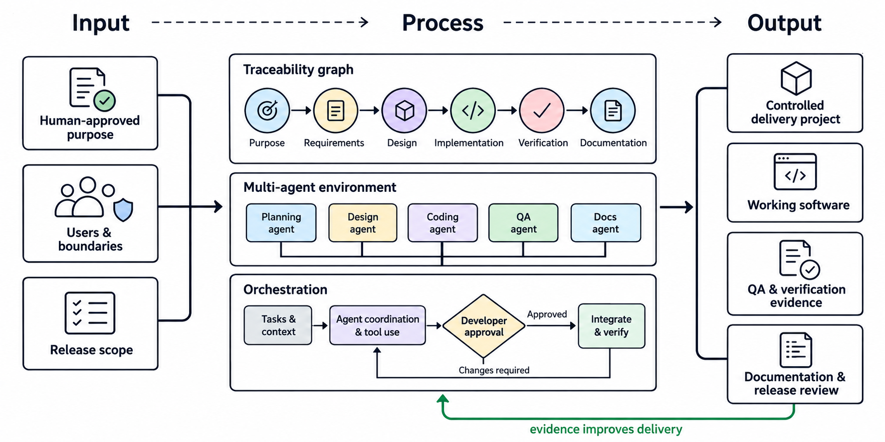

# Code-worker

> A graph-orchestrated, evidence-driven framework for agent-oriented software
> delivery.



[](https://github.com/genilab/code-worker/releases)
[](https://www.python.org/)
[](skills/INFO.md)

## What it does

Code-worker is a reusable template for developers who want agents to help
deliver software without losing human control. It records a traceable path from
purpose through requirements, implementation, verification, documentation, and
release review:

```text
purpose -> requirement -> design -> implementation -> verification -> documentation
```

The local runner implements eight public actions. It creates and updates only
local lifecycle records; it never commits, pushes, tags, changes a remote, or
publishes a release.

## Current status

- Eight public workflow actions are implemented and QA-validated.
- The standard-library integration suite has six passing tests.
- The framework still needs a real delivery-project pilot and human-approved
  release review before it can be considered release-ready.

See [implementation status](assets/docs/project/implementation_status.md) and
[reboot QA](assets/docs/qa/reboot_qa.md) for the evidence record.

## Start a delivery project

Use Code-worker as a GitHub template to create a new, independent destination
repository. Clone that destination repository—not the Code-worker master—into
the folder where you will build the product.

```sh
git clone https://github.com/{your-account}/{your-delivery-project}.git /path/to/your-delivery-project
cd /path/to/your-delivery-project
python3 src/code_worker.py --help
```

Initialize the project with its explicit controls:

```sh
python3 src/code_worker.py project-init \
  --project . \
  --name "My Project" \
  --release "0.1.0" \
  --roadmap "Next release to be defined" \
  --visibility private \
  --artifact-policy tracked
```

`project-init` refuses the Code-worker master repository and an origin pointing
back to it. It creates only missing baseline files and does not alter Git
tracking, so it is safe to rerun with the same controls.

## Public workflow

| Action | Command | Result |
| --- | --- | --- |
| `Project init` | `project-init` | Establishes an independent project baseline and control records. |
| `Define Modules` | `define-modules` | Records modules, dependencies, risks, owner, and delivery plan. |
| `Define requirements {module}` | `define-requirements` | Records a testable requirement and acceptance criterion. |
| `Develop {module}` | `develop` | Records existing source and test evidence for an approved module. |
| `Verify {module}` | `verify` | Runs an explicit check and stores its actual output and result. |
| `Maintain documentation [ALL \| {module}]` | `maintain-documentation` | Audits local documentation links and records the result. |
| `Review release` | `review-release` | Evaluates evidence and records readiness; never publishes. |
| `Show info [ALL \| {topic}]` | `show-info` | Displays an existing INFO document without changing the project. |

Use `python3 src/code_worker.py <command> --help` for every command's required
arguments. The workflow contracts are catalogued in [skills/INFO.md](skills/INFO.md).

## Minimal end-to-end example

```sh
python3 src/code_worker.py define-modules \
  --project . --module catalog --goal "Expose the product catalog"

python3 src/code_worker.py define-requirements \
  --project . --module catalog --id CAT-1 \
  --description "Return the product catalog" \
  --acceptance "A caller receives one or more product records"

# Implement source and tests yourself in src/ and tests/.
python3 src/code_worker.py develop \
  --project . --module catalog \
  --implementation src/catalog.py \
  --test tests/test_catalog.py

python3 src/code_worker.py verify \
  --project . --module catalog \
  --check python3 -m unittest discover -s tests -v

python3 src/code_worker.py maintain-documentation --project . --scope catalog
python3 src/code_worker.py review-release --project . --release 0.1.0
```

A failing verification command remains visible as `FAILED`; it cannot become a
pass by documentation update. A release becomes only `READY_FOR_HUMAN_APPROVAL`
until a developer explicitly records the human decision.

## Delivery-project structure

```text
{project-folder}/
├── src/                         # product source
├── tests/                       # executable tests
├── skills/                      # project-local skills
├── assets/
│   ├── images/                  # infographics and project images
│   ├── reports/                 # generated audits and reports
│   └── docs/                    # all maintained project documentation
│       ├── plan/
│       ├── requirements/
│       ├── qa/
│       └── release/
├── AGENTS.md
├── INFO.md
└── README.md
```

Project assets belong beneath `assets/`. Documentation belongs beneath
`assets/docs/`; `assets/images/` is the required location for infographics.
Local `INFO.md` files are the navigation standard.

## Guardrails

- Humans approve scope, design, consequential tradeoffs, manual acceptance,
  external publication, and release.
- Verification runs the command supplied by the developer without a shell and
  preserves its real exit code and output.
- Release review evaluates evidence but never commits, pushes, tags, or
  publishes.
- The active project must be independent of Code-worker; delivery work never
  commits back to this template repository.

## Development and QA

Run the framework's own tests from this repository:

```sh
python3 -m unittest discover -s tests -v
```

The suite covers project initialization, module and requirement definition,
development evidence prerequisites, verification pass/fail handling,
documentation auditing, release-review states, and the command-line dispatcher.

## Navigation

- [Project information](INFO.md)
- [Skill catalogue](skills/INFO.md)
- [Documentation records](assets/docs/INFO.md)
- [Asset guidance](assets/INFO.md)
- [Operating rules](AGENTS.md)

## License

See [LICENSE](LICENSE).
