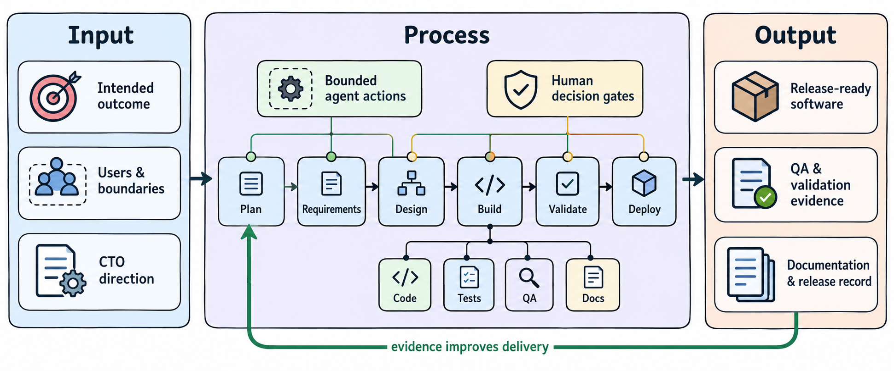

<h1 align="center">Code-worker</h1>

<p align="center">
  <strong>Controlled, evidence-driven software delivery for AI-enabled teams.</strong>
</p>

<p align="center">
  
</p>

<p align="center">
  <a href="https://github.com/kochf1/code-worker/releases">
    
  </a>
  <a href="https://www.python.org/">
    
  </a>
  <a href="skills/INFO.md">
    
  </a>
</p>

## What is Code-worker?

Code-worker is a reusable foundation for teams that want to build software with
AI while keeping the work clear, reviewable, and connected to the intended
outcome. It gives a developer, CTO, or delivery team an organized way to move
from a project purpose through requirements, design, implementation,
verification, documentation, and release review.

Its multi-agent structure maintains that delivery flow by routing work through
specialized roles and reusable skills. The structure keeps decisions,
requirements, source changes, test evidence, and documentation connected, then
returns important tradeoffs, experience review, and release approval to a
human decision-maker.

### What makes it different?

- **Outcome-to-evidence delivery.** Each requirement connects the intended
  result to design, implementation, verification, and supporting records.
- **Human decision gates.** The developer retains approval for scope, design,
  meaningful tradeoffs, experience acceptance, publication, and release.
- **Structured multi-agent work.** An orchestrator routes work to focused
  roles for requirements, architecture, implementation, testing,
  documentation, and release review.

## Getting started

Create an independent delivery repository from the Code-worker GitHub template,
then clone that repository into the destination folder where you want to build
your software. The cloned folder becomes your delivery workspace.

```sh
git clone https://github.com/{your-account}/{your-delivery-project}.git /path/to/your-delivery-project
cd /path/to/your-delivery-project
```

With the delivery workspace installed, you can begin structuring the work:

- Initialize the project: `Project init {folder}`.
- Define its purpose: `Create or revise charter`.
- Plan the work: `Plan delivery`.
- Define the first module: `Define requirements {module}`.

## Available actions

- `Project init {folder}` — initializes an independent delivery project from
  its charter through its initial structure and current-release scope.
- `Create or revise charter` — establishes the human-approved project purpose,
  users, boundaries, and success criteria.
- `Plan delivery` — turns the charter into a current-release scope, roadmap,
  modules, and delivery plan.
- `Define requirements {module}` — defines measurable requirements and
  acceptance criteria for one module.
- `Design {module}` — records the user flow, architecture, interfaces, and
  tradeoffs for an approved module.
- `Implement {work item}` — builds one approved requirement slice.
- `Verify {module}` — records actual automated verification evidence.
- `Review experience {journey}` — records manual or visual verification of a
  user journey.
- `Maintain documentation` or `Sync documentation [scope]` — updates verified
  records and their INFO navigation.
- `Review release` — checks traceability, verification, documentation, and
  release readiness without publishing.

## Examples

### Academic research portal

Imagine you need to build a portal that helps a research group organize and
share a literature corpus. You can use Code-worker to define the intended
experience before implementation. Proceed as follows:

- Establish the portal purpose: `Create or revise charter`.
- Plan the first delivery: `Plan delivery`.
- Define the library-search module: `Define requirements literature search`.
- Design the search experience: `Design literature search`.

### Office approval workflow

Imagine you need to build an internal tool for submitting and approving office
requests. You can use Code-worker to preserve the approval rules and evidence
for each delivery step. Proceed as follows:

- Establish the workflow purpose: `Create or revise charter`.
- Define the approval module: `Define requirements request approval`.
- Design its roles and decisions: `Design request approval`.
- Build and verify the approved work item: `Implement {work item}`, then
  `Verify request approval`.

### Product release preparation

Imagine you need to prepare a completed feature for a human release decision.
You can use Code-worker to bring its evidence and documentation together.
Proceed as follows:

- Verify the completed module: `Verify {module}`.
- Review the customer journey: `Review experience {journey}`.
- Refresh verified records: `Maintain documentation`.
- Prepare the decision evidence: `Review release`.
