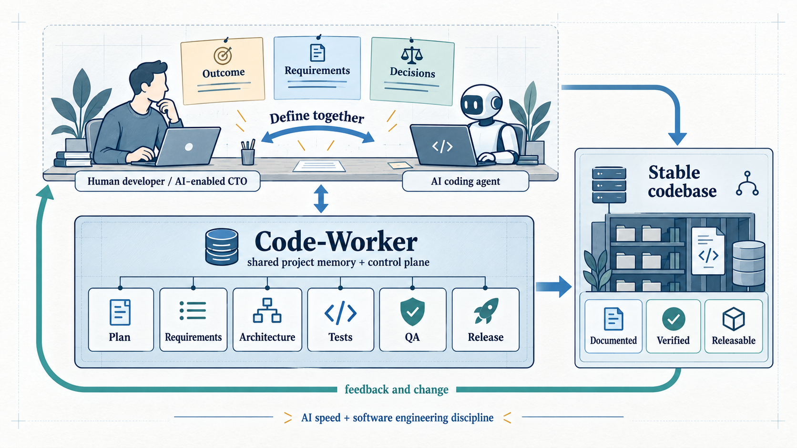

<h1 align="center">Code-Worker</h1>

<h3 align="center">A clear way to guide AI-powered software delivery with confidence.</h3>

<p align="center">
  
</p>

## Build with AI. Still run engineering.

Code-Worker applies the principles of software engineering to bring control and
transparency to AI-driven coding processes. It gives a human developer and an
AI coding agent a shared, repeatable way to turn an intended result into a
planned, tested, documented, and releasable codebase.

It is not another coding agent, and it does not replace Codex or Claude Code.
Those tools are excellent at helping create and change code. Code-Worker is the
development-control layer around that work: the place where the team makes the
scope, decisions, requirements, evidence, and release state explicit.

## Why it exists

AI can produce useful code in minutes. But a growing codebase needs more than
useful code: it needs a shared understanding of the intended result, clear
boundaries, requirements that can be checked, test evidence, quality records,
documentation, and a disciplined way to release changes.

Without those things, the project can become a sequence of capable but opaque
agent sessions. It is hard to answer basic CTO questions:

- What are we actually building, and why?
- Which requirement led to this implementation?
- What changed, what was tested, and what is safe to release?
- Where is the current source of truth when a new person or agent joins?

Code-Worker closes that gap. It keeps the control artifacts of the software
development lifecycle close to the work, so speed from AI does not come at the
cost of traceability, quality, or maintainability.

## The working loop

```text
Desired result
  → Plan and boundaries
  → Requirements and modules
  → Architecture and implementation
  → Tests and QA evidence
  → Documentation and release
  → A codebase that the next human or agent can understand
```

The solution architecture above shows the same outcome-to-evidence loop:
human judgment directs the work, an AI coding agent accelerates it, and
Code-Worker keeps the decisions and evidence connected.

## What Code-Worker gives you

- A planning conversation that starts with the finished result, who will use
  it, what it must produce, and how success will be recognized.
- Explicit project plans, module requirements, architecture, release plans,
  and roadmap records.
- A way to connect a requirement to implementation, executable tests,
  validation, and recorded QA evidence.
- Maintained indexes so people and agents can find the current plan, evidence,
  and next action without guessing.
- A reusable skill structure for repeatable development workflows.

The human developer still owns the product decisions. The agent asks,
organizes, challenges ambiguity, and proposes options; it does not silently
invent the product plan.

## Get started

Start a new project from a copy of this repository, then open that folder in
your AI coding environment:

```bash
git clone https://github.com/kochf1/code-worker.git project-x
cd project-x
```

Start the planning conversation with:

```text
Plan project
```

Code-Worker will begin with the end state you want—not with a presumed package
structure. Together, you define the outcome, users, inputs, outputs,
constraints, and acceptance evidence. It then proposes the modules,
architecture direction, initial release, and roadmap for you to confirm before
implementation starts.

After planning, begin each piece of work from `.dev/INDEX.md`.

## How the control package works

Code-Worker versions its master development-control package in `.dev/`. When
you use it for a target project, that project's `.dev/` records remain local
and are added to the target's `.gitignore`. This keeps planning notes,
requirements, QA evidence, and project-specific skills in the working
environment while Code-Worker itself remains a reusable template.

## What it is not

Code-Worker is not a replacement for product thinking, technical leadership,
or engineering review. It does not claim that a passing test suite makes every
decision correct. It provides a practical operating structure so those
decisions, their implementation, and the evidence behind them remain visible.

## Example

GraphK is the first target application: Code-Worker is used to turn its
graph-execution framework into explicit module requirements, implementation
work, test evidence, QA records, and planned releases.

## License

See [LICENSE](LICENSE).
